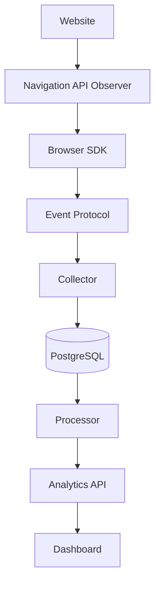

<p align="center">
  
</p>

<h1 align="center">Traceleaf</h1>

<p align="center">Self-hosted web analytics</p>

<p align="center">
  <a href="README.zh-CN.md">简体中文</a>
</p>

<p align="center">
  <a href="https://github.com/bearfighting/web-analytics-platform/actions/workflows/ci.yml"></a>
  <a href="LICENSE"></a>
</p>

Traceleaf is self-hosted website analytics for teams who want to understand how people use their sites while keeping analytics data and infrastructure under their control.

The MVP is a browser analytics workflow from page navigation through reporting. Its feature scope is frozen; the current implementation baseline and open release or deployment work are recorded in [MVP Scope](docs/mvp-scope.md) and [Project Status](docs/project-status.md).

## Try the Playground

Requirements: Node.js 26.10.0 and pnpm 12.6.0.

```bash
pnpm install
pnpm dev
```

Open <http://localhost:3000> to explore the Next.js navigation playground. It uses a mock transport by default to show browser events locally; it does not send data through the full Collector, PostgreSQL, Processor, API, and Dashboard workflow. For the complete local stack, follow [Getting Started](docs/getting-started.md).

## MVP Capabilities

- Page views, anonymous visitors, sessions, and browser context
- Referrer, UTM, language, timezone, device, browser, and operating system dimensions
- Framework-independent navigation observation through the browser Navigation API
- Custom events, Web Vitals, conversions, and funnels
- Country-level Geo reporting
- Site capabilities, Origin allowlists, ingest keys, and environment policies
- Dashboard reporting and site configuration

This scope does not imply production deployment acceptance or public Browser SDK availability. The Browser SDK GitHub Release and real deployment acceptance are still pending; see [Project Status](docs/project-status.md) for the authoritative follow-up list.

## Architecture



The Observer reports committed browser navigations. The SDK collects browser context and creates protocol events. The Collector validates and stores incoming events; the Processor derives analytics; the Dashboard queries reports through the Analytics API.

| Area                                                                          | Responsibility                                            |
| ----------------------------------------------------------------------------- | --------------------------------------------------------- |
| `packages/observer-core`                                                      | Browser Navigation API observation                        |
| `packages/analytics-browser`, `packages/analytics-core`, `packages/transport` | Browser collection and event delivery                     |
| `protocol/`, `packages/protocol-ts`                                           | Language-neutral event contract and TypeScript types      |
| `services/collector`, `services/processor`, `services/analytics-api`          | Ingestion, processing, and analytics queries              |
| `apps/dashboard`                                                              | Analytics reports and site configuration                  |
| `examples/`                                                                   | Browser and framework playgrounds for navigation behavior |

The Observer and analytics core do not depend on a specific router. Playground examples do not provide router adapters.

## Documentation

- [Getting Started](docs/getting-started.md) — local development and full Compose stack
- [MVP Scope](docs/mvp-scope.md) — accepted feature baseline and boundaries
- [Project Status](docs/project-status.md) — unfinished, deferred, and release-blocking work
- [Event Protocol](docs/event-protocol.md) — event contract guidance
- [Operations Guide](docs/operations.md) — operating the services and handling data
- [Deployment guides](docs/deployment-linux.md) — Linux deployment; see also [Raspberry Pi deployment](docs/deployment-raspberry-pi.md)
- [Documentation Index](docs/README.md) — guides, decisions, and project records
- [MIT License](LICENSE)
