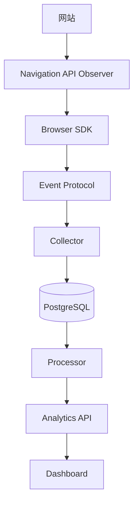

<p align="center">
  
</p>

<h1 align="center">Traceleaf</h1>

<p align="center">自托管网站分析</p>

<p align="center">
  <a href="README.md">English</a>
</p>

<p align="center">
  <a href="https://github.com/bearfighting/web-analytics-platform/actions/workflows/ci.yml"></a>
  <a href="LICENSE"></a>
</p>

Traceleaf 面向希望了解网站使用情况、同时将分析数据和基础设施保留在自己掌控之下的团队，提供自托管网站分析。

MVP 覆盖从页面导航到报表的一条浏览器分析链路，功能范围目前已冻结。当前实现基线及未完成的发布或部署工作见 [MVP 范围](docs/mvp-scope.md) 和[项目状态](docs/project-status.md)。

## 体验 Playground

要求：Node.js 26.10.0 和 pnpm 12.6.0。

```bash
pnpm install
pnpm dev
```

打开 <http://localhost:3000> 体验 Next.js 导航 Playground。默认使用 mock transport 在本地展示浏览器事件；它不会经过完整的 Collector、PostgreSQL、Processor、API 和 Dashboard 链路。启动完整本地栈请参阅[开始使用](docs/getting-started.md)。

## MVP 能力

- 页面浏览、匿名访客、会话和浏览器上下文
- 来源、UTM、语言、时区、设备、浏览器和操作系统维度
- 通过浏览器 Navigation API 进行框架无关的导航观察
- 自定义事件、Web Vitals、转化和漏斗
- 国家级 Geo 报表
- 站点 capability、Origin 白名单、Ingest Key 和环境策略
- Dashboard 报表和站点配置

这些范围不代表生产部署已验收或 Browser SDK 已公开发布。Browser SDK 的 GitHub Release 和实机部署验收仍未完成；权威后续事项清单见[项目状态](docs/project-status.md)。

## 架构



Observer 报告浏览器已提交的导航。SDK 采集浏览器上下文并创建协议事件。Collector 校验并存储收到的事件；Processor 派生分析结果；Dashboard 通过 Analytics API 查询报表。

| 目录                                                                          | 职责                                  |
| ----------------------------------------------------------------------------- | ------------------------------------- |
| `packages/observer-core`                                                      | 观察浏览器 Navigation API             |
| `packages/analytics-browser`、`packages/analytics-core`、`packages/transport` | 浏览器端采集与事件传输                |
| `protocol/`、`packages/protocol-ts`                                           | 跨语言事件协议和 TypeScript 类型      |
| `services/collector`、`services/processor`、`services/analytics-api`          | 接收、处理和分析查询                  |
| `apps/dashboard`                                                              | 分析报表和站点配置                    |
| `examples/`                                                                   | 验证导航行为的浏览器与框架 Playground |

Observer 和分析核心不依赖特定路由库。Playground 示例不提供路由专用 adapter。

## 文档

- [开始使用](docs/getting-started.md) — 本地开发和完整 Compose 栈
- [MVP 范围](docs/mvp-scope.md) — 已接受的功能基线与边界
- [项目状态](docs/project-status.md) — 未完成、暂缓和发布阻塞事项
- [Event Protocol](docs/event-protocol.md) — 事件协议说明
- [运维指南](docs/operations.md) — 服务运行和数据处理
- [部署指南](docs/deployment-linux.md) — Linux 部署；另见 [Raspberry Pi 部署](docs/deployment-raspberry-pi.md)
- [文档索引](docs/README.md) — 指南、决策和项目记录
- [MIT 许可证](LICENSE)
